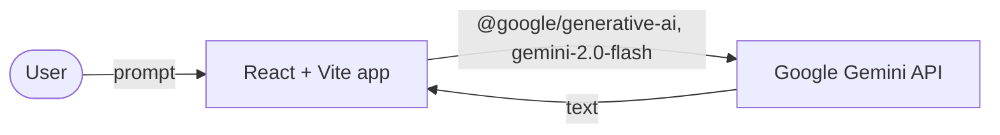

# Mini Anon AI (Gemini Clone): High-Level Design

A Gemini-style chat interface: type a prompt, get a streamed-looking answer from Google's Gemini model, with recent prompts in a collapsible sidebar. Live at [mini-anon-ai.vercel.app](https://mini-anon-ai.vercel.app). For code-level detail see the [Low-Level Design](lld.md).

## 1. Context

The app calls Gemini directly from the browser; there is no backend.

## 2. Components

| Component | Responsibility |
|---|---|
| Sidebar | New chat, recent prompts (click to re-run), help / activity / settings icons; expands and collapses |
| Main | Greeting with suggestion cards, prompt box (Enter to send), result area with loader and typing effect |
| Context provider | Shared state and `onSent()` |
| `config/gemini.js` | Model setup and `run(prompt)` |

## 3. Tech

| Item | Choice |
|---|---|
| UI | React 19 + Vite, Context API |
| AI | `@google/generative-ai`, model `gemini-2.0-flash`, temperature 1, max 8192 tokens |
| Hosting | Vercel |

## 4. Known limits

| Limit | Note |
|---|---|
| API key in the browser | `VITE_GEMINI_API_KEY` is bundled into the client and visible to users; a small server route would keep it secret |
| No memory | Each prompt starts a new chat session with empty history |
