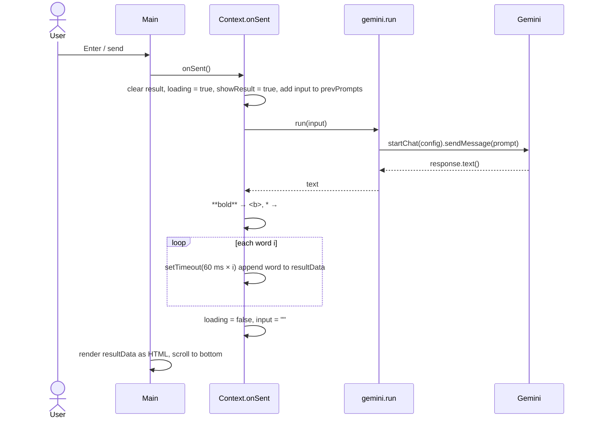

# Mini Anon AI (Gemini Clone): Low-Level Design

For the big picture see the [High-Level Design](hld.md).

## 1. Source layout (`Gemini Clone/src`)

| File | Role |
|---|---|
| `main.jsx` | Wraps `<App />` in `ContextProvider` |
| `App.jsx` | `<Sidebar />` + `<Main />` |
| `context/context.jsx` | State and `onSent`, `newChat`, `delayPara` |
| `config/gemini.js` | `run(prompt)` |
| `components/sidebar/sidebar.jsx` | `extended` toggle, `loadPrompt(prompt)` |
| `components/main/main.jsx` | Cards, prompt textarea (2 rows on ≤ 600 px), result view, auto-scroll |

## 2. Shared state

| State | Meaning |
|---|---|
| `input` | Current prompt text |
| `recentPrompt` | Prompt shown above the answer |
| `prevPrompts` | History shown in the sidebar |
| `showResult` | Greeting vs result view |
| `loading` | Loader bars while waiting |
| `resultData` | HTML string being typed out |

## 3. Sending a prompt

## 4. Formatting rules

| Model output | Rendered as |
|---|---|
| Text between `**` pairs | `<b>…</b>` |
| Single `*` | Line break ` ` |
| Words | Appended one by one every 60 ms (typing effect) |

The result is inserted with `dangerouslySetInnerHTML`, so only trusted model output should reach it.
